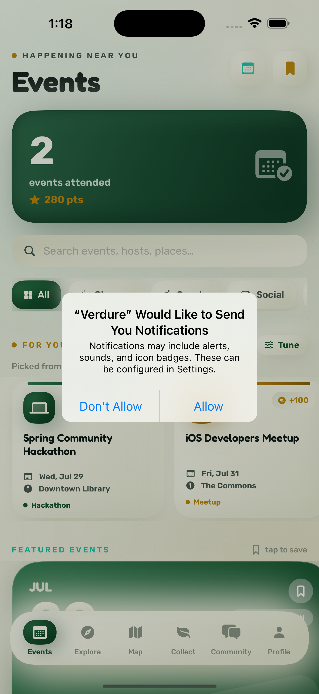
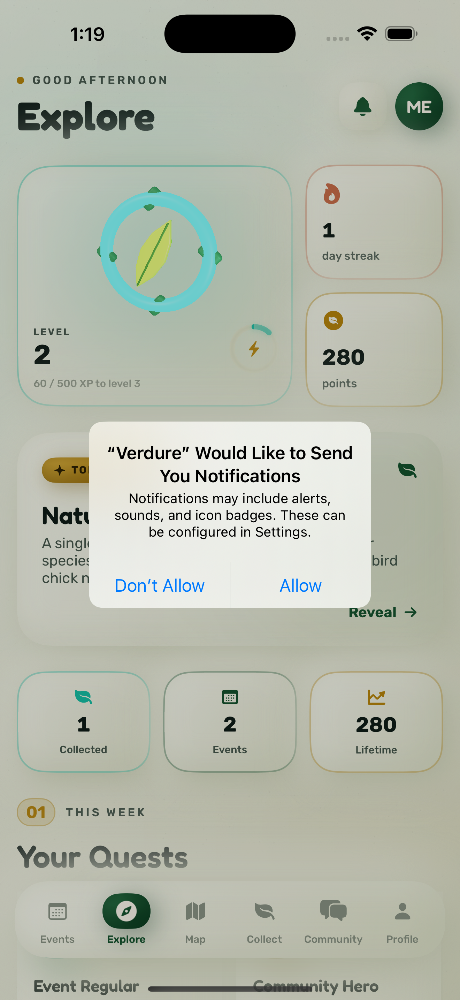
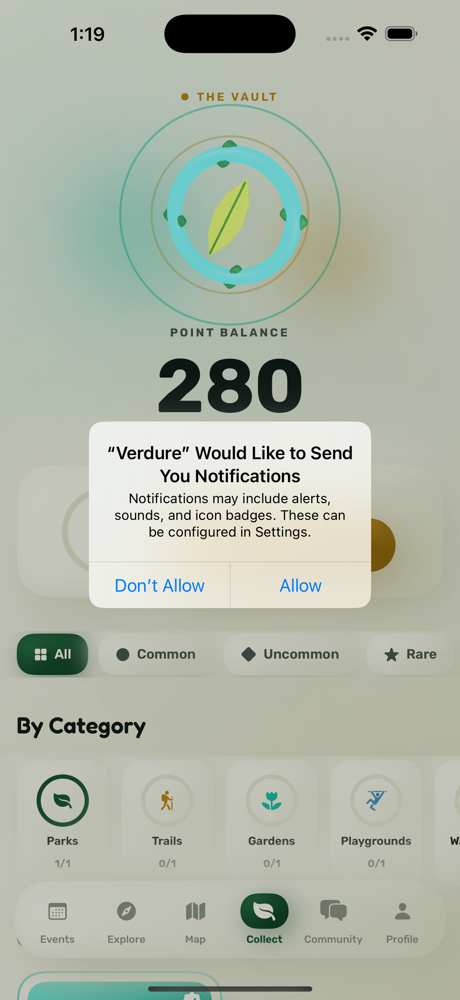
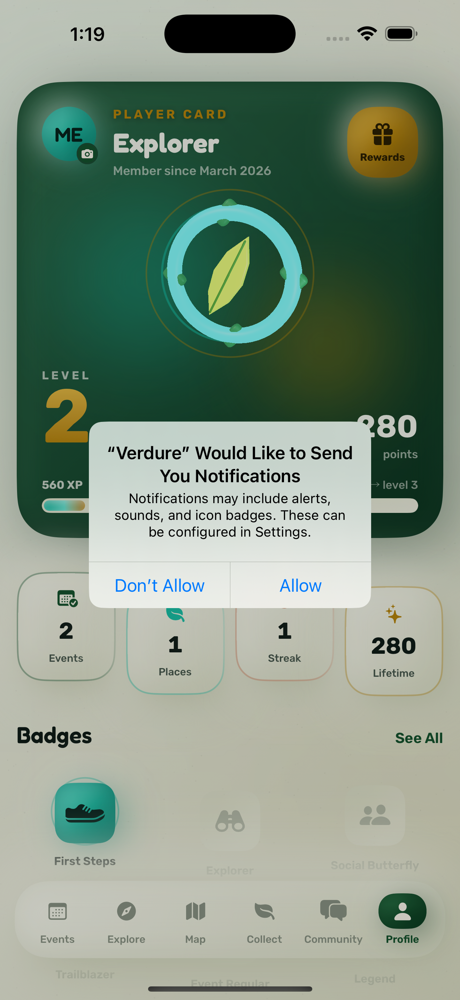

# Verdure

**Step Outside. Connect Within.**

An iOS app that turns your neighborhood into something worth exploring. Find the
parks, trails and community events around you, show up in person, and turn time
outside into real rewards.

<p>
  
  
  
  
</p>

---

## What it does

- **Discover** real nearby places from OpenStreetMap, the National Park Service
  and Recreation.gov, plus real community events.
- **Collect** places you actually visit — rarity tiers from Common parks to
  Legendary overlooks, gated on real GPS proximity.
- **Check in** at events to earn points. Attendance is verified with your
  location *and* a proof photo, validated server-side.
- **Progress** through streaks, monthly challenges and badges computed from what
  you genuinely did.
- **Redeem** points for gift cards, including limited-time seasonal drops.
- **Verdure+** (optional): premium reward tiers, early access to drops, member badge.

## Design principles

Two rules shape most of the code:

1. **Nothing is fabricated.** If a data source doesn't provide a rating, review
   count, attendee number or opening hours, the app shows nothing rather than
   inventing a plausible number. Sample data exists only as a labelled cold-start
   fallback and is never mixed into real content.
2. **Points are server-authoritative.** The client never writes its own balance.
   Every earn and redemption goes through a Cloud Function; Firestore rules deny
   client writes to `pointsBalance`, `lifetimePoints`, `checkedInEventIDs`,
   `redeemedRewardIDs` and `plusExpiresAt`.

## Architecture

```
Verdure/                    Xcode project (XcodeGen — edit project.yml, not the .xcodeproj)
  Verdure/
    Models/                 GameStateManager (@Observable), API services, GamificationEngine
    Views/                  6 tabs: Events, Explore, Map, Collect, Community, Profile
    Components/             ClayKit (claymorphism), ClayMotion, SceneKit medallion
    Theme/                  "Warm Forest" palette, Fredoka/Rubik type ramp
  VerdureTests/             Unit tests
  VerdureUITests/           Journey tests + Apple accessibility audits
functions/                  Cloud Functions (TypeScript) — all point math lives here
  scripts/e2e-backend.mjs   Full backend E2E against the local emulator suite
Verdure Website/            Next.js marketing site (also hosts /privacy and /support)
AppStore/                   Submission pack: listing copy, screenshots
firestore.rules             Production lockdown
storage.rules               Proof-photo ownership rules
```

**Offline-first earning.** Check-ins apply optimistically, spool the proof photo
to disk, and queue a durable pending op. The queue replays automatically when
connectivity (and the backend) return — the callables are idempotent, so replays
are safe. The client only treats the server's balance as truth after a callable
has actually round-tripped, so an unreachable backend can never wipe local
progress.

## Running it

```bash
cd Verdure && xcodegen generate      # required after adding/removing files
open Verdure.xcodeproj               # ⌘R on an iPhone simulator (iOS 17+)
```

Firebase config lives in `Verdure/Secrets.xcconfig` (gitignored). External data
providers self-disable when their key is absent, so the app runs without any keys.

## Testing

```bash
# iOS: unit + UI journeys + accessibility audits
cd Verdure && xcodebuild test -project Verdure.xcodeproj -scheme Verdure \
  -destination 'platform=iOS Simulator,name=iPhone 16 Pro'

# Backend: full server contract against local emulators (needs Java 17+)
cd functions && npm run e2e
```

| Suite | Count | Covers |
|---|---|---|
| Unit | 38 | Transactions, cloud-merge safety, gamification, Daily Gem, sanitizer, reward windows |
| UI + a11y | 16 | Journeys across every tab + Apple accessibility audits on 8 screens |
| Backend E2E | 33 | Rules lockdown, check-in proof/GPS validation, entitlement gating, redemption |

UI tests inject deterministic state through launch arguments (`-QATab`,
`-QAOfflineData`, `-QADisableMotion`) — see [`QA.md`](QA.md).

## Deploy status

⚠️ **Cloud Functions and Storage are not deployed** — the project is on the
Spark plan and Functions require Blaze. Firestore rules *are* live. See the
verified status table at the top of [`CLAUDE.md`](CLAUDE.md) for what that means
and how to re-check it.

```bash
npx firebase-tools deploy --only firestore:rules     # works today
npx firebase-tools deploy --only functions,storage   # needs Blaze + Storage init
```

## Docs

| File | What's in it |
|---|---|
| [`CLAUDE.md`](CLAUDE.md) | Architecture, design system, deploy status, changelog |
| [`QA.md`](QA.md) | Test strategy, QA harness, known issues |
| [`AppStore/LISTING.md`](AppStore/LISTING.md) | Listing copy, privacy label, review notes, blockers |
| [`SECURITY.md`](SECURITY.md) | Threat model and the reasoning behind each control |
| [`BACKEND.md`](BACKEND.md) | Cloud Functions and rules detail |
